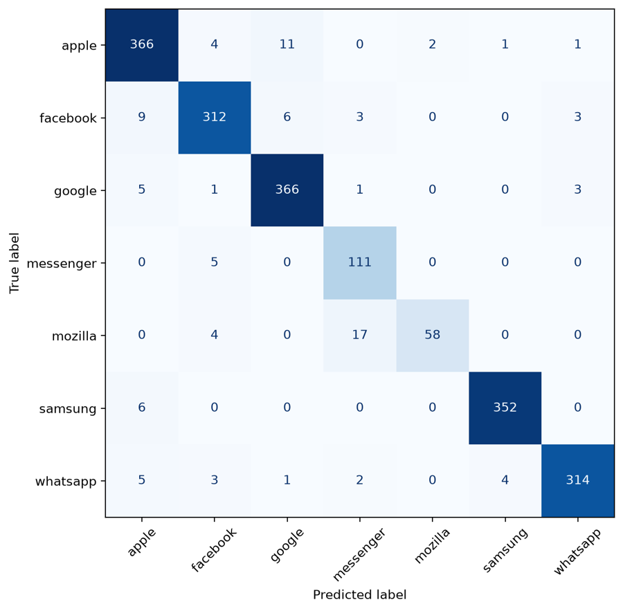

# Emoji Provider Classification

A CNN trained from scratch that recognises which company drew an emoji (Apple, Google, Samsung, WhatsApp, Facebook, Messenger or Mozilla) from its style alone. It scores 94.9% on the Kaggle test set.

<p align="center">
  
</p>
<p align="center"><sub>Validation confusion matrix (1,976 images). Full write-up: <a href="docs/report.pdf">report (PDF)</a></sub></p>

## Why I built it

This was the final project of the Computer Vision course in my BSc AIDAMS (ESSEC × CentraleSupélec), run as a private Kaggle competition. The same emoji looks slightly different on every platform, so the content of the image is no help: the model has to learn each company's drawing style.

Group project of four with Jawad Mallat, Victor Henz and Adem Ben Njima. Jawad wrote most of the code and the data loader. **I wrote the metrics and performance analysis of the report (sections 5 and 6):** per-provider precision, recall and F1, and what the remaining errors reveal about the model.

## Approach and results

- **Data:** 9,879 training images in 7 imbalanced classes (Mozilla has 397 images, the largest classes about 1,900).
- **Model:** a 4-block CNN with 1.18M parameters, batch normalisation, dropout and label smoothing.
- **Key finding:** the input mattered more than the architecture. Keeping each image's transparency channel and original file size raised validation accuracy from 92.5% to 95.3%, and cut Facebook/WhatsApp confusions from 38 to 4.
- **Result:** 94.9% accuracy on Kaggle (94.9% again on a second run), consistent with 95.1% on validation.

## How it works

Images are resized to 72×72 with the transparency channel kept separately. The original size and format of each file are encoded as 9 extra features and added just before the final classifier, since they are not part of the picture.

Three decisions shaped the project:
- **A small CNN over a pre-trained ResNet.** ResNet-18 reached 97.3%, but only with ImageNet weights, 224-pixel inputs and 7× the training time. We kept a model we could explain layer by layer.
- **No data augmentation.** Flips and colour changes lowered accuracy by up to 2.5 points, because a provider is recognised precisely by the colours and positions they change.
- **Accuracy alone hides a weak class.** Overall accuracy is 95.1%, but balanced accuracy is 92.7%: Mozilla recall is only 73%, and 17 of its 21 misses are predicted as Messenger, which uses the same file size. Class weighting fixes it but costs a point of accuracy, so we kept the leaderboard-optimal model and reported the trade-off.

**Stack:** Python, PyTorch, scikit-learn, NumPy, pandas, uv.

## Run it

```bash
uv sync
# put the competition data in data/ (train/, test/, train_labels.csv)
uv run --with nbconvert jupyter nbconvert --to notebook --execute --inplace emoji_classification.ipynb
```

The notebook writes its predictions to `submission.csv`.

## Limitations

- The dataset comes from a private course competition, so it is not included in the repository.
- Mozilla is still the weakest class (73% recall), because it has few images and shares its file size with Messenger.
- Apple and Google remain hard to tell apart, since both use the same file format and only the drawing differs.
